# Roommate

**A robot dog that lives in a physics twin of a real apartment, thinks with DimOS, and walks through the real rooms in
Apple Vision Pro.**

  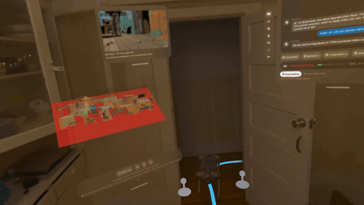
   
  Recorded on Vision Pro in a real apartment. Asked in chat to come to Living Room 2, the robot plans a route
  through the scanned twin and walks 10.6 m. For about 10 s it's out of sight behind the real walls. Here it comes back
  through the doorway and stops 0.28 m from the goal.

Roommate is a companion that doesn't physically exist but is always somewhere real. A LiDAR scan of the home becomes
a physics world, and a simulated Unitree robot dog lives in it. Its brain is
[DimOS](https://github.com/dimensionalOS/dimos), Dimensional's open-source robot operating system, with Claude as its
voice and judgement. Apple Vision Pro shows the robot 1:1 in the real rooms, hidden behind the real walls and
furniture. You can talk to it, send it from a map, pat it and play fetch with it, and it sees you back.

Everything runs on one Mac and one Vision Pro. The robot's body is simulated. The home, the headset and the person
wearing it are real.

> The source code is private. For access, a demo or a conversation, contact me through my GitHub profile.

## What it does

All of these clips were recorded on the headset in a real apartment on 6 November 2026. The robot's lines are its own,
generated by Claude.

| | |
|---|---|
| **Send it from the map.** Pinch a room's label on the floating map, a small copy of the scanned home. The robot sets off at once and stops 0.24 m from the goal 15.8 s later. The small window streams what its head camera sees. | 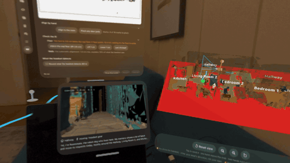 |
| **Play fetch.** Throw a ball with your real hand. It bounces off the real walls and appliances. Here the ball lands behind the dog: it hears the bounce, turns to look, finds the ball 1.7 s later and brings it back. | 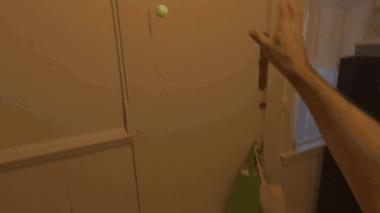 |
| **Pat it.** Pat its head and hearts float up in the same instant. A few seconds later it answers in its own words: "That feels nice. Thanks for the pats." | 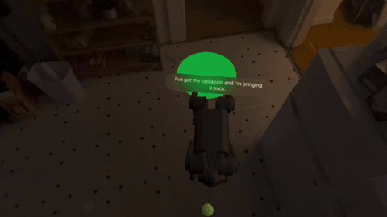 |
| **Ask for a trick.** Ask for a heart and it sits up on its hind legs at 62° for 3.2 s and traces a 21 cm heart in the air with both front paws. That's a real balanced move in the physics sim, not an animation. | 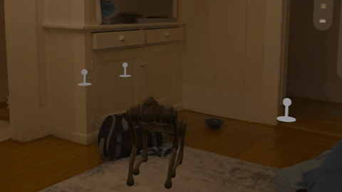 |
| **A paw for your hand.** Hold out a palm and ask for a handshake. If you're out of reach it steps closer, then sits and rests a front paw in your hand. In testing it landed on 130 of 144 palms in reach (90%) with no falls. | 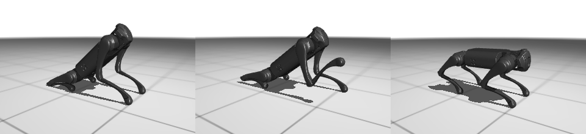 |
| **Follow me.** Ask it to follow and the dog, here in its Shiba look, trails you out of the room and down the hallway. | 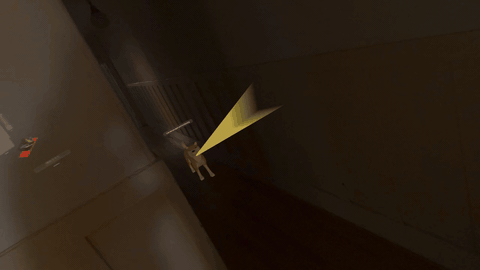 |

It also hides behind your real walls, finds its way to any named room on request, can be picked up and put down
somewhere else, answers "Can you see my legs?" truthfully from its own camera, and responds to Siri ("Where is
Roommate?").

## In the simulation

Everything below is synthetic: a test apartment, the visionOS Simulator and the robot sim, with no real home in it.

<table>
  <tr>
    <td width="50%">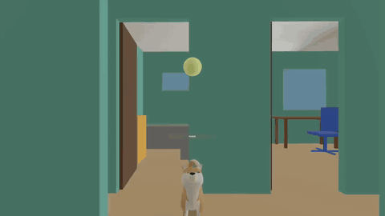 
      Fetch in the visionOS Simulator: the Shiba chasing the ball through the test apartment.</td>
    <td width="50%">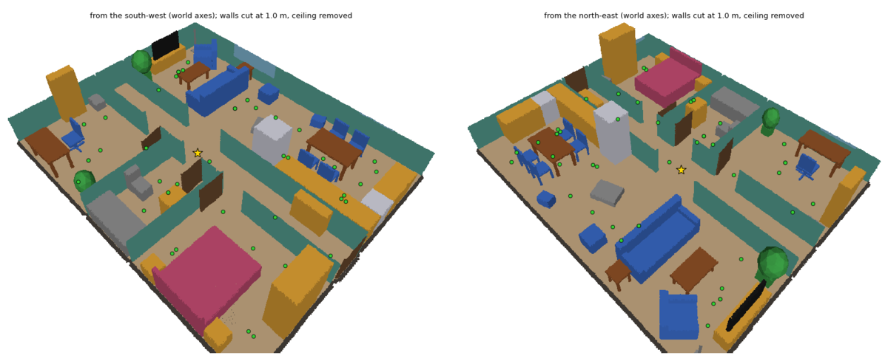 
      The twin of the test apartment, with the walls cut at 1 m. The green dots are the places the robot knows by name.</td>
  </tr>
  <tr>
    <td>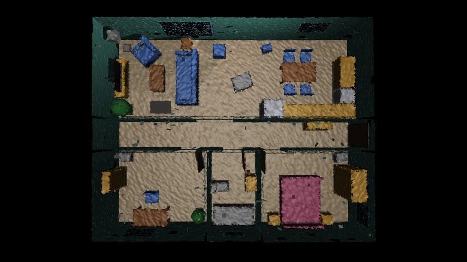 
      The same apartment rebuilt from a deliberately flawed scan, with holes, drift and doubled floors. It still makes a walkable world.</td>
    <td>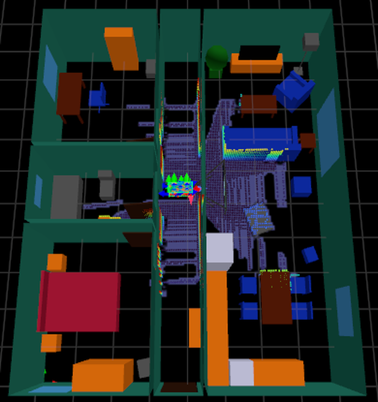 
      The robot's own view in DimOS: standing in the twin, with its lidar map building up around it.</td>
  </tr>
  <tr>
    <td>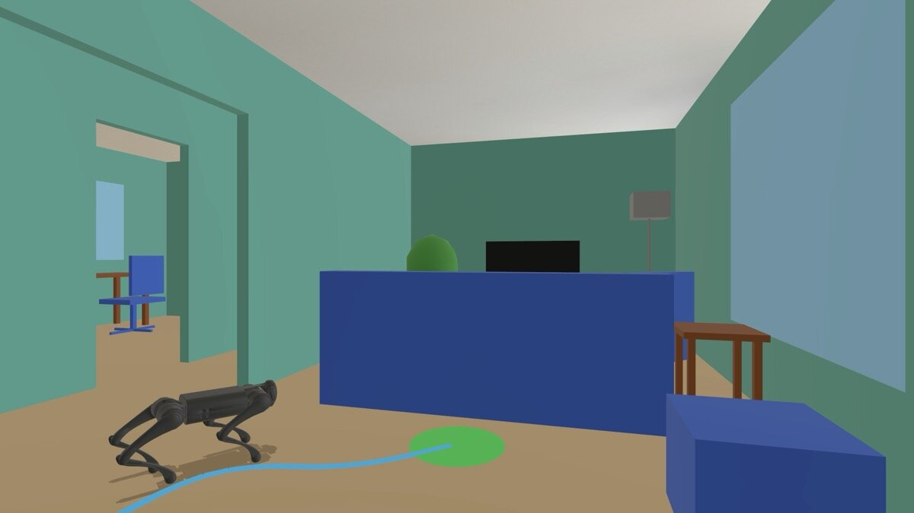 
      Pinch a spot on the floor and the robot walks there, updated 100 times a second.</td>
    <td>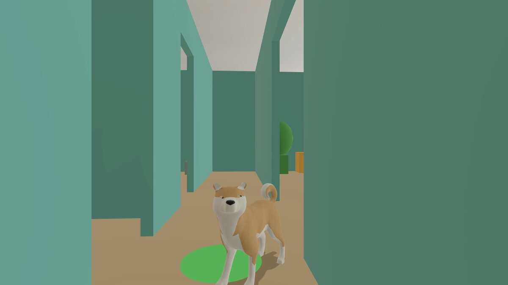 
      The Shiba look on its goal ring. Every step it takes is the simulated robot's own.</td>
  </tr>
  <tr>
    <td>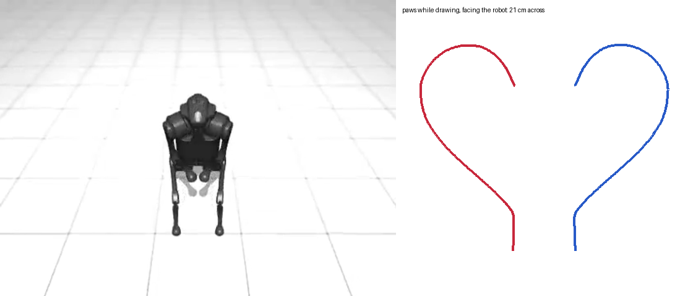 
      The finger heart in the sim, and the heart the two front paws traced (21 cm across).</td>
    <td>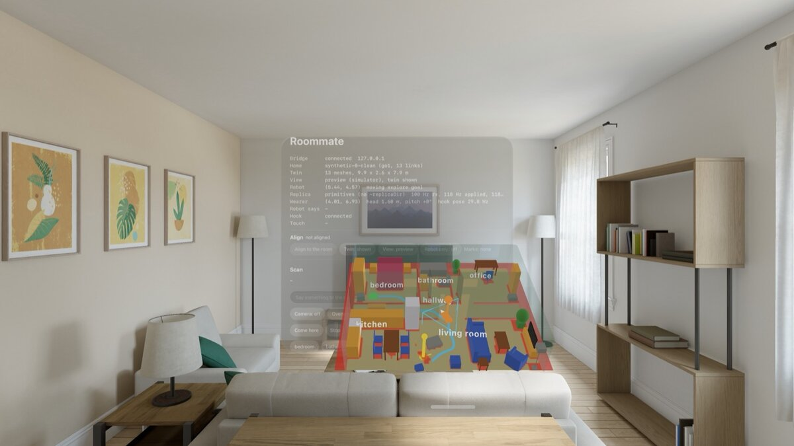 
      The floating map: the whole home as a dollhouse, with the robot and its route.</td>
  </tr>
  <tr>
    <td>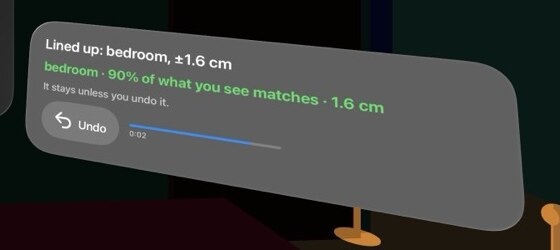 
      Look around and the headset finds which room you're in and lines up with the scan by itself.</td>
    <td>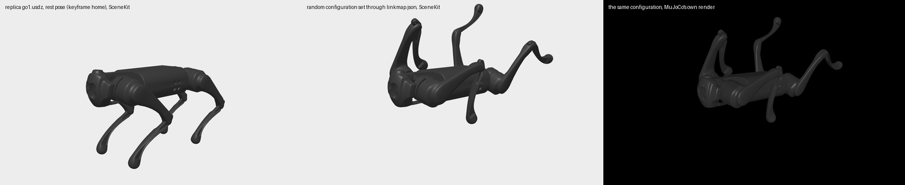 
      1:1: the robot drawn in the headset matches the physics sim's own render of the same pose.</td>
  </tr>
</table>

## Measured

  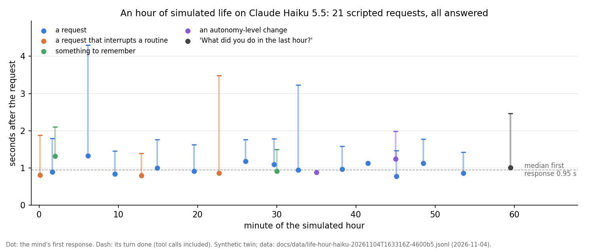

An hour of simulated life with Claude Haiku as the mind: 21 spoken requests at set times, including errands,
interruptions of the robot's own routines and things to remember. All 21 were answered, with a median first response
of 0.95 s. The whole hour cost **$0.014**. At the end, asked what it had done, the robot accounted for 14 of 14 facts,
including the trips that stopped short.

  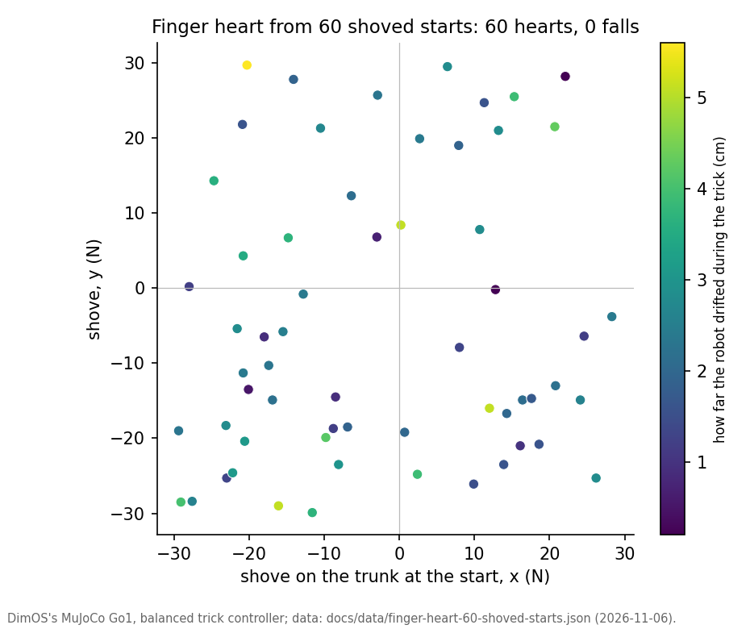

The finger heart is a real balanced move, not an animation. Started 60 times with a random shove of up to 30 N, it drew
60 hearts with no falls. It exists because an earlier version said "executed successfully" while nothing moved. Now
the robot does its tricks for real, and declines the ones it can't do in words.

| Moment, from the headset clips | Measured |
|---|---|
| Spoken request to a planned path on the real floor | 0.87 s |
| Walk to Living Room 2, hidden behind real walls for about 10 s | 10.6 m; arrived 0.28 m from the goal |
| Pinch on the map to arrival | 0.24 m from the goal after 15.8 s |
| A throw, measured from the hand | 3.15 m/s |
| Ball behind the dog: heard, searched for, found | found 1.7 s later |
| Pat on the head to hearts / to its reply | the same instant / 2.97 s |
| The robot's body in the headset | 100 updates a second, drawn 1:1 |
| Headset lined up with the scan | within about 2 cm of the scanned walls |
| Simulation speed in the full apartment | real time (1.00×) |
| Apartment tour | every reachable place visited, 0 falls |

## Status

- **The body is simulated.** Nothing here has run on real robot hardware yet; a real Unitree body is the next step.
- **Alignment is good, not perfect.** On the headset it lined itself up in 8 of 11 tries. The rest were rooms that look
  alike, settled with a pinch or two, or cancelled.
- **Only a few tricks are real:** the finger heart, a hip wiggle, the paw and a spin learned from real dog motion.
  Asked for anything else, the robot says honestly that it can't.

## How it was built

Roommate was built between 3 and 6 November 2026 by one person directing a team of Claude Code agents working in
parallel. The private repository holds over 1,200 commits, nearly 400 design-decision records and nearly 2,000
automated tests.

## Credits

- [DimOS](https://github.com/dimensionalOS/dimos) by Dimensional (Apache-2.0): the robot stack Roommate runs in.
- [MuJoCo](https://mujoco.org) and [MuJoCo Menagerie](https://github.com/google-deepmind/mujoco_menagerie): physics and
  the Unitree models.
- The iPad capture app is based on [3D Model Anything](https://github.com/wesbos/3d-model-anything) by Wes Bos (MIT).
- The Shiba Inu model is by [Quaternius](https://poly.pizza/m/y4wdQpg767) (CC0).
- Claude by Anthropic is the robot's mind. Apple's visionOS, RealityKit and ARKit run the headset side.

## Licence

Copyright (c) 2026 Matthew Thomas. All rights reserved. See [LICENSE](LICENSE).
